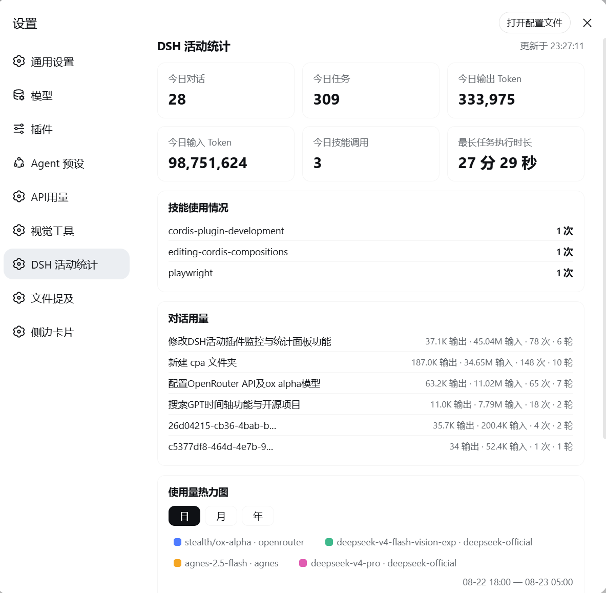
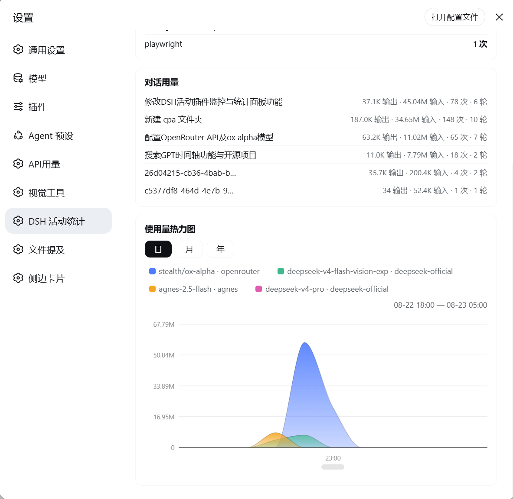
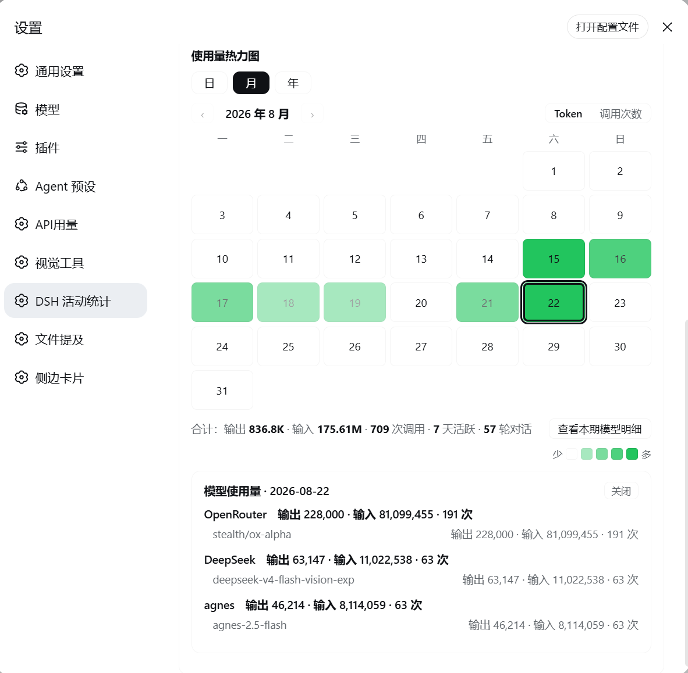
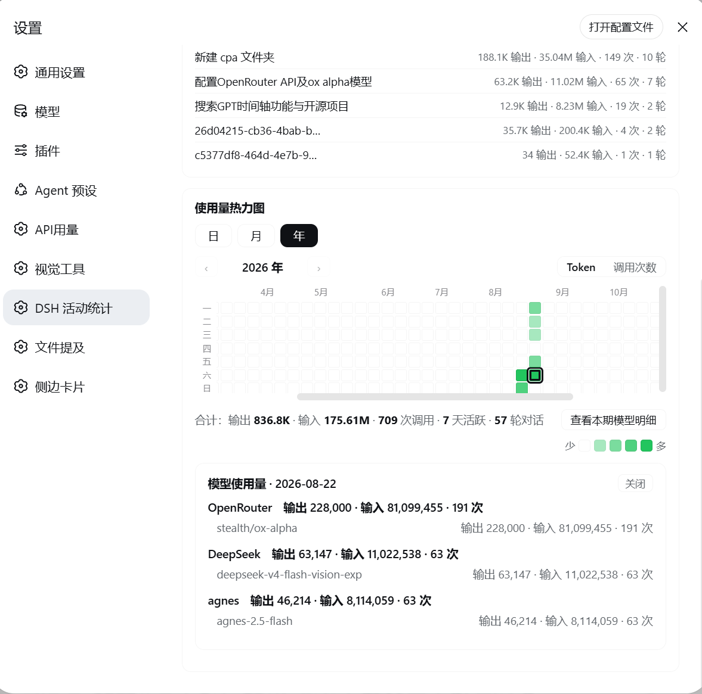

# dsh-plugin-dsh-activity

DeepSeek Harness 用量监控插件：对话 / 技能 / 工具 / Token 全链路统计，设置面板内可视化。

## 功能

- **今日统计卡**：对话数、任务步骤、输出/输入 Token、技能调用、最长任务执行时长
- **日视图**：按模型着色的单调平滑堆叠曲线（渐变填充），水平滚动条浏览前后 3 天，悬浮显示逐小时各模型明细，点击曲线隔离高亮
- **月视图**：日历热力图 + ‹› 月份导航 + 合计栏（输出/输入总量、调用次数、活跃天数、对话轮数）+ Token/调用次数切换
- **年视图**：GitHub 风格全年热力图（星期列固定），点击任意日期下钻
- **模型明细下钻**：任意周期按供应商 → 模型两级展开输出/输入/调用次数
- **技能与工具监控**：当日各技能、工具的调用次数

## 预览

### 界面截图





## 架构

```
┌────────────── Host（Node.js 静态插件）──────────────┐
│ src/index.js                                        │
│ • llm/stream 瀑布流 → provider 上报 TokenUsage      │
│   按 provider→model 归因到小时/天桶                  │
│ • session/event → 轮次/步骤计数与任务时长            │
│ • tools/result → 工具与技能调用统计                  │
│ • 持久化：<DSH_HOME>/storages/…usage.json           │
│   深度相加合并（历史永不覆盖）+ 原子写 + 损坏隔离    │
│ • webServer 路由：snapshot / models / calendar      │
└─────────────────────────────────────────────────────┘
                     │ fetch
┌────────────── Client（浏览器 bundle）───────────────┐
│ client/bundle.js                                    │
│ settings.section 设置页：六卡 + 堆叠曲线 + 热力图    │
└─────────────────────────────────────────────────────┘
```

## 安装

```bash
dsh plugin --profile web add file:<本目录绝对路径>
```

或复制到 profile 的 node_modules 并把包名加入 `dsh.profile.bundles`。重启 DSH 后打开 设置 → DSH 活动统计。

## 数据保留

小时桶 8 天（日视图浏览窗口 ±3 天）、天粒度 400 天（支撑年导航）。数据全部存于本机。

## License

MIT

## 兼容性（dsh 0.2.x / 桌面版）

- 要求 dsh `>=0.2.1-rc.2 <0.3.0`（`engines.dsh`，0.2.1 起声明）。
- 宿主路由 `/dsh-activity/snapshot`、`/dsh-activity/models`、`/dsh-activity/calendar` 均为相对路径；桌面版把 `dsh-app://app` 下的未知路径转发给本地 host，因此同样可用。
- 安装：包名加入 `dsh.profile.bundles`（自带 `dsh.bundle.patch`）。

### 0.2.2 — 修复「只记得今天的活动」

- **根因**：宿主在 `apply()` 里一次性捕获 `fs` / `sessionPersistence`。0.2.x 起这两个服务在本插件 `apply()` 之后才挂载，捕获到的是 `undefined`
  → `ensurePersistTarget()` 永远返回 `null` → 每天只写内存，`~/.dsh/storages/dsh-activity-usage.json` 自 2026-09-10 之后就没再被写过。
- 改为**惰性解析**：`getFs()` / `getPersistence()` / `getLlm()` / `getSessions()` / `getSessionTitle()` 每次用时再取。
- 主目录解析改为**不依赖宿主服务**：`DSH_HOME` → `<os.homedir>/.dsh`（确认 `storages/` 存在），都失败才回落到旧的服务推导；失败会打一行日志。
- `loadState()` 在目标/服务缺失时**不再缓存"什么都没读到"的 promise**，下次调用会重试，避免永久停在内存模式。
- 自检：`test/persist.test.mjs` —— 模拟"服务晚于 apply 挂载"的真实顺序，断言会写出当天的桶、并且**保留旧历史**（用 2026-09-10 的数据做对照）。旧版跑这个用例直接挂掉。
